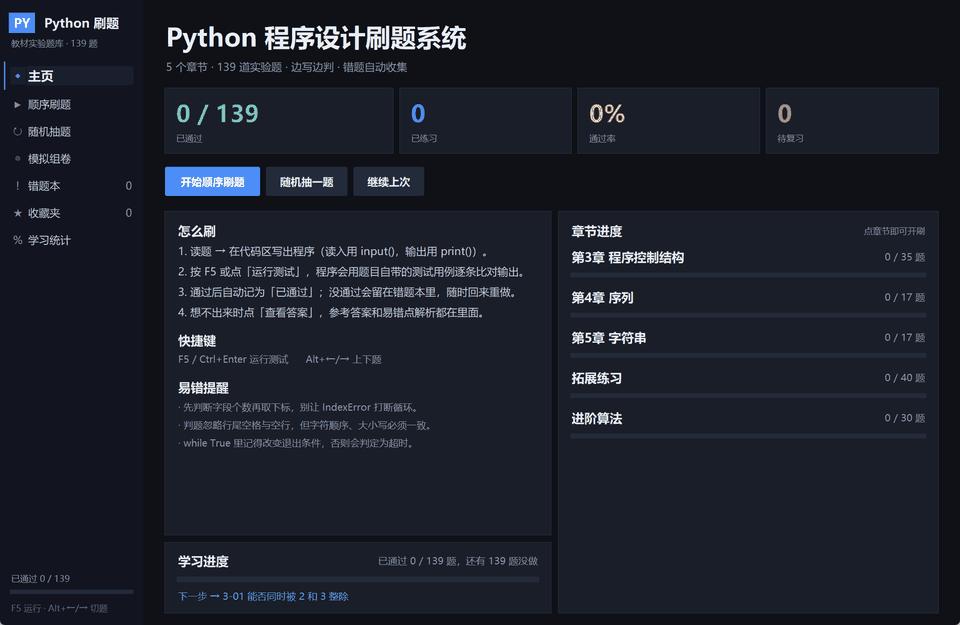
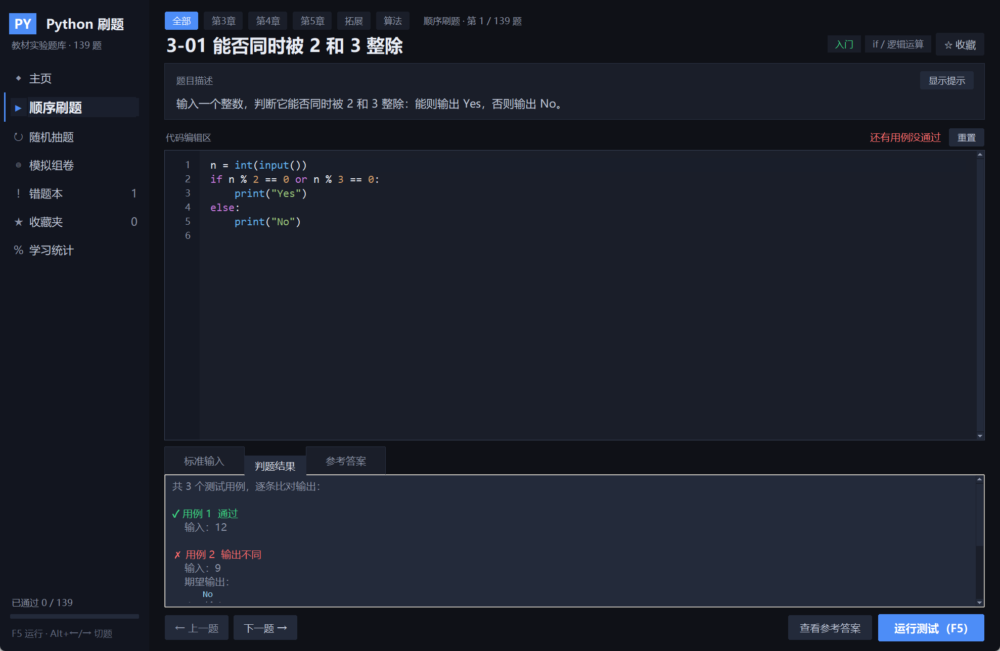
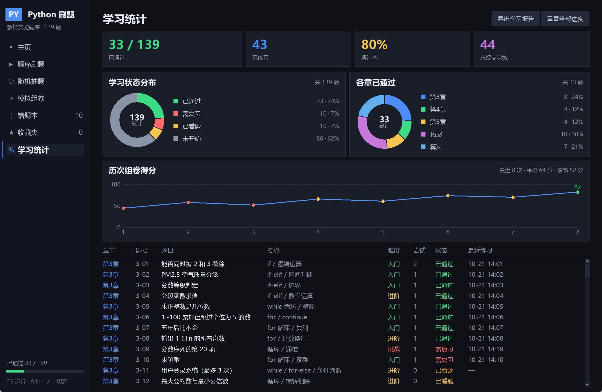
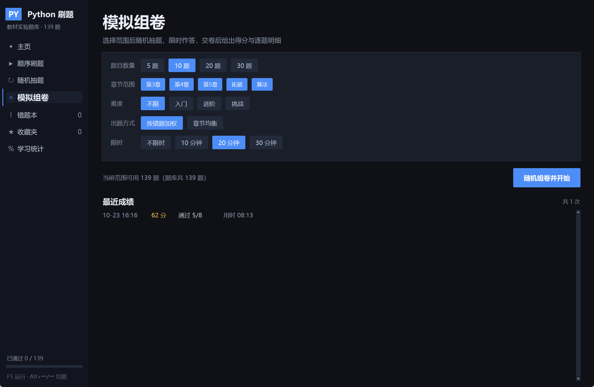
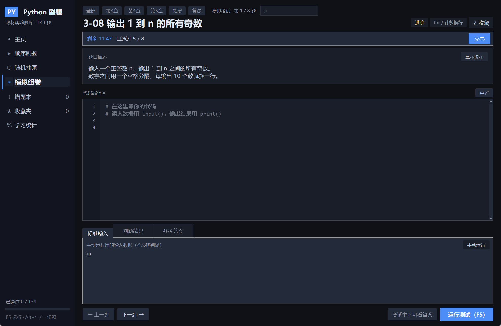
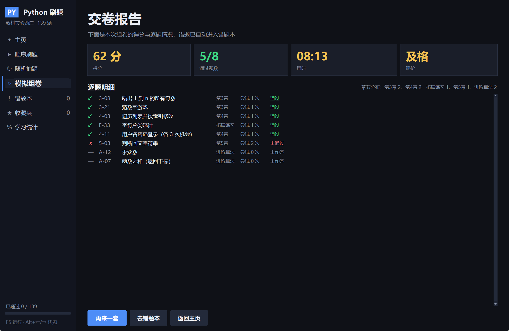

# Python 程序设计刷题系统

**简体中文** ｜ [**English**](README.en.md)
- 如果大家对于这个程序还有想要的效果和功能欢迎联系我，我也是00后可以接受梗的，邮箱：zz12@foxmail.com 欢迎骚扰！！！想要一起开发的可以找我！！！
[](https://github.com/telling890/python-quiz-system/actions/workflows/selftest.yml)
[](LICENSE)
[](https://www.python.org/)
[](#)
[](selftest.py)

把教材《Python 程序设计实验指导与习题解答》第 3～5 章的实验题做成一个可以**边写边判**的桌面刷题程序：
写完代码按 F5 就能跑，程序会用题目自带的测试用例逐条比对输出，通过的题自动记录，没通过的自动进错题本。

> **演示视频**：[docs/演示视频.mp4](docs/演示视频.mp4)（27 秒，1080p）
> **直接下载**：[Release 附件](https://github.com/telling890/python-quiz-system/releases/latest/download/Python-quiz-system-portable.zip)（8.9 MB，解压后双击 `Python刷题系统.exe`，无需安装 Python）· [仓库内副本](downloads/Python-quiz-system-portable.zip)
> **或者 clone 本仓库**：直接双击 `dist/Python刷题系统/Python刷题系统.exe` 就能运行（目录版已随仓库提供）
> **在线看文档**：[项目汇报](docs/pdf/5-项目汇报.pdf) · [答辩 PPT](docs/pdf/4-答辩演示.pdf) · [需求](docs/pdf/1-需求说明书.pdf) · [设计](docs/pdf/2-设计文档.pdf) · [测试](docs/pdf/3-测试报告.pdf)

- 可执行文件：`dist/Python刷题系统/Python刷题系统.exe`（免安装目录版，双击运行，约 21 MB）
- 功能：顺序/随机刷题、判题、错题本、收藏、统计（饼图 + 得分趋势）、模拟组卷（可按错题加权）、题目搜索、导出 CSV、导入自定义题库
- 便携压缩包：`downloads/Python-quiz-system-portable.zip`（8.9 MB，拷贝/分发用这个）
- 源码运行：`python main.py`；重新打包：`python build.py`
- 题库：**139 道**（教材第3章 35 + 第4章 17 + 第5章 17，拓展练习 40，进阶算法 30），**338 个测试用例**
- 自动测试：GitHub Actions 在每次推送时用 Python 3.8 / 3.11 跑题库自检与组卷自检



> 动图依次演示：主页 → 刷题 → 判题反馈 → 统计饼图 → 组卷配置 → 交卷报告（静态截图见 `shots/`）

---

## 一、怎么打开

1. **两种拿法**：下载 [便携版 zip](downloads/Python-quiz-system-portable.zip) 解压，或者直接 `git clone` 本仓库后进 `dist/Python刷题系统/`。
   双击里面的 `Python刷题系统.exe`，整个文件夹可以拷到 U 盘或任意一台 Windows 电脑。
2. 如果弹出蓝色的 **「Windows 已保护你的电脑」**（Win11 Smart App Control 对未签名程序的默认提示），
   点 **更多信息 → 仍要运行**。
3. 启动约 1～2 秒。程序不解压临时文件、不依赖 `%TEMP%`、不写注册表。

> 为什么不是单个 exe：PyInstaller 的**单文件模式**启动时要先把内容解压到 `%TEMP%`，
> 有些机器（本项目开发机就是）引导器建不了临时目录，会直接弹
> `INTERNAL ERROR: cannot create temporary directory!`。
> 目录版启动时完全不解压，从根上避开这个问题，所以在任何电脑上都更稳。

---

## 二、界面与功能

### 主页

左侧导航 + 四个统计卡片 + 章节进度（点章节直接从该章第一道未通过的题开始）+ 「怎么刷」「快捷键」「易错提醒」。

### 刷题页



- 顶部一排「全部 / 第3章 / 第4章 / 第5章」可以随时切换章节。
- 题目卡显示描述，点「显示提示」展开该考点的方法提示。
- 代码编辑区：行号、语法高亮、Tab 缩进 4 格、回车自动缩进、`:` 后自动补一级缩进。
- 下方三个标签页：
  - **标准输入**：手动运行用的数据（不参与判分），
  - **判题结果**：每条用例的通过情况、期望输出、实际输出、第一个不一致的行、针对性提示，
  - **参考答案**：参考代码 + 易错点解析，可一键载入编辑器。
- 右下角「运行测试 (F5)」判题；全部通过后状态栏变绿，这道题记为已通过。


### 错题本 / 收藏夹

做错或没通过的题会自动收进错题本；题目右上角「☆ 收藏」可以单独攒一份复习清单。
两个列表都支持直接跳题、重新提交，通过后自动移出错题本。

### 学习统计



页面顶部是四张指标卡 + **两张饼图**（学习状态分布 / 各章已通过）+ **历次得分趋势折线图**，下方是逐题明细表；右上角「导出学习报告」会把汇总、各章进度、组卷记录与逐题明细写成一个 CSV（Excel 双击即开）：
点任意一行跳到那道题。「重置全部进度」会清空记录、收藏和保存的代码。

### 模拟组卷（考试）



左侧导航「模拟组卷」：选择题量（5/10/20/30）、章节范围（5 章可多选）、难度、限时，
点「随机组卷并开始」生成一套卷子。组卷按章节轮转抽题，保证各章都有覆盖；题量不足会直接提示。

考试模式下顶部有倒计时与「已通过 x/n」，章节切换被禁用、
「查看答案」变成「考试中不可看答案」，避免考试时直接对答案：



交卷（手动或倒计时归零自动）后进入成绩报告：得分、评价、用时、逐题明细
（✓ 通过 / ✗ 未通过 / — 未作答）与本次卷子的章节分布，成绩写入历史记录：



### 快捷键

| 按键 | 作用 |
| --- | --- |
| `F5` / `Ctrl+Enter` | 运行测试 |
| `Alt+←` / `Alt+→` | 上一题 / 下一题 |
| `Ctrl+F` | 聚焦搜索框（按题号/标题/考点/题干搜题） |
| `Tab` | 插入 4 个空格 |

---

## 三、题库一览

| 章节 | 题数 | 用例数 | 内容 |
| --- | --- | --- | --- |
| 第3章 程序控制结构 | 35 | 78 | 分支、循环、图形输出、穷举、级数近似、登录流程等 |
| 第4章 序列 | 17 | 30 | 列表/元组/字典/集合操作、切片、嵌套结构、队列模拟 |
| 第5章 字符串 | 17 | 54 | 回文、切片、字典计数、字符校验、同构字符串等 |
| 拓展练习 | 40 | 89 | 网络经典题集：提成计算、杨辉三角、约瑟夫环、凯撒密码、游程编码等 |
| 进阶算法 | 30 | 87 | 冒泡/选择/插入/快排、二分查找、Kadane、LIS、背包、数字三角形、栈、回溯等 |

> 第 4 章的教材原文是 36 个零散「小操作」+ 8 道编程题，这里按考点合并成 17 道可判题的完整题目，
> 每题给出固定的初始数据和输出格式。

**拓展练习从哪来**：选题参考公开题集 [Python100Cases](https://github.com/RichardFu123/Python100Cases)
（腾讯云有转载：[链接](https://cloud.tencent.com.cn/developer/article/1774665)）以及常见入门练习清单。
题干按本系统的判题约定重写、参考答案与测试用例全部自行编写（不是复制原题解），
每题的「参考答案」页顶部会标注对应的原题编号，方便回溯。

**进阶算法**：排序、查找、递归、栈、贪心与简单动态规划的入门经典题（Kadane 最大子段和、
最长递增子序列、0/1 背包、数字三角形、约瑟夫环、摩尔投票等），用来承接学完教材后的算法过渡。

每道题都带：题目描述、方法提示、参考答案、测试用例、解析与易错点。
解析里会指出教材示范代码本身的问题（例如第 5 章第 2 题 `while` 条件恒真、第 8 题重复打印），
这些正是课堂上的高频失分点。

---

## 四、判题规则

- 学习者的代码在受限环境里执行：`input()` 从测试用例取数据且**不回显提示语**
  （所以 `input("name: ")` 里的 `name: ` 不会混进输出），`print` 的输出被捕获后用来比对。
- 比对时**忽略**行尾空格、连续空格、空行，但字符、顺序、大小写必须一致。
- 金字塔、等腰三角形这类靠缩进排版的题使用 **raw 模式**：行首空格也参与比较。
- 单次运行 6 秒超时，死循环会判定「运行超时」而不是卡死界面。
- 出现 `EOFError`（要的输入比用例多）、`NameError`、`SyntaxError`、`TypeError` 等会给出对应提示。
- 为安全起见，练习环境禁止 `os.system`、`subprocess`、`shutil.rmtree`、`ctypes` 等调用。

---

## 五、目录结构

```
quiz_app/
├─ .github/workflows/selftest.yml   CI：推送时自动跑题库与组卷自检
├─ downloads/
│  └─ Python-quiz-system-portable.zip  ← 便携版安装包（8.9 MB，仓库内直接下载）
├─ docs/
│  ├─ 1-需求说明书.docx / 2-设计文档.docx / 3-测试报告.docx
│  ├─ 4-答辩演示.pptx / 5-项目汇报.docx
│  ├─ pdf/                     ← 上面 5 份的 PDF 版（GitHub 可在线预览）
│  └─ build_docs.py / build_ppt.py / build_report.py   ← 文档生成脚本
├─ shots/                    界面截图（README 与 PPT 用）
├─ main.py                   程序入口（DPI 适配、异常兜底）
├─ ui.py                     五个页面：主页 / 刷题 / 统计 / 组卷 / 交卷报告
├─ widgets.py                自绘控件：圆角按钮、导航项、代码编辑器、滚动容器、饼图
├─ theme.py                  配色、字体、屏幕缩放
├─ judge.py                  判题引擎：沙箱执行 + 输出归一化比对
├─ exam.py                   组卷与评分（随机抽题 / 限时 / 统计）
├─ ui_exam.py                组卷配置页与交卷报告页
├─ qbank.py                  题库汇总（按章节组织）
├─ bank_ch3.py / bank_ch4.py / bank_ch5.py   教材三章题库
├─ bank_extra.py / bank_algo.py              拓展练习 / 进阶算法题库
├─ store.py                  进度持久化（收藏 / 错题 / 代码 / 考试历史）
├─ selftest.py               题库自检：跑一遍所有参考答案
├─ build.py                  一键打包（自检 → 生成图标 → PyInstaller）
├─ _test_exam.py             组卷系统自检（10 项）
├─ _shoot.py / _shoot_exam.py / _interact.py  开发辅助：截图 / 交互冒烟测试
├─ assets/app.ico            应用图标（build.py 生成）
├─ LICENSE                   MIT
└─ pylibs/                   打包用 PyInstaller 5.13.2（不入库）
```

---

## 六、导入自己的题库

程序支持导入 JSON 格式的题库，导入后会作为「自定义题库」章节并入，能刷题、能组卷、也会进错题本。

**格式**：一个数组，或者 `{"questions": [...]}`。每道题最少要有 `title` / `desc` / `ref` / `cases` 四个字段：

```json
{
  "id": "C-01",
  "title": "求三个数的最大值",
  "topic": "if / 比较",
  "level": 1,
  "desc": "输入三个整数，输出其中最大的一个。",
  "hint": "可以两两比较，也可以用 max()。",
  "ref": "a, b, c = map(int, input().split())\nprint(max(a, b, c))",
  "cases": [
    { "stdin": "1 2 3\n", "expect": "3" },
    { "stdin": "9 2 5\n", "expect": "9" }
  ],
  "explain": "max() 可以一次比较多个值。"
}
```

- `level`：1 入门 / 2 进阶 / 3 挑战（可省略，默认 1）
- `cases`：`stdin` 喂给 `input()`，`expect` 是期望输出；图形题加 `"raw": true` 保留行首空格
- 可选 `source` 字段标注来源

**怎么导入**：主页点「导入题库」选文件即可。导入时程序会用每题的参考答案跑一遍用例，
要是某几题的答案对不上，会直接告诉你是哪几号题，方便先修再发。

模板见 [`docs/题库模板.json`](docs/题库模板.json)，导入的题库保存在
`%LOCALAPPDATA%\PyQuizState\custom_bank.json`，删掉这个文件就恢复成内置题库。

---

## 七、重新打包

环境要求：Python 3.8+、网络（首次装依赖）。

```bat
:: 1) 把新版 PyInstaller 装到项目内的 pylibs
::    （系统里的 PyInstaller 3.6 不支持 Python 3.8）
python -m pip install --target pylibs "pyinstaller==5.13.2"

:: 2) 一键打包（内部会先跑 selftest 自检题库）
python build.py
```

产物：`dist\Python刷题系统\`（目录版，约 21 MB）和 `dist\Python刷题系统-便携版.zip`（约 8.9 MB）。
打包脚本固定使用 `--onedir`：单文件模式（`--onefile`）启动要解压到 `%TEMP%`，
在个别机器上会报 `INTERNAL ERROR: cannot create temporary directory!`，不要改回去。

- 只验证题库：`python selftest.py`，全部通过退出码为 0。
- 交互冒烟测试：`python _interact.py`。
- 重新生成文档与 PPT：
  `python docs\build_docs.py`、`python docs\build_ppt.py`。

### 改题库

编辑 `bank_ch3.py` / `bank_ch4.py` / `bank_ch5.py` 里的 `QUESTIONS`，按同样字段加一条：

```python
{
    "id": "5-18",              # 题号，前缀是章节
    "chapter": "第5章 字符串",
    "no": 18,                  # 教材题号
    "title": "题目名",
    "topic": "考点标签",
    "level": 2,                # 1 入门 / 2 进阶 / 3 挑战
    "desc": "题目描述（含输入输出约定）",
    "hint": "方法提示",
    "ref": "参考答案代码\n",
    "cases": [{"stdin": "输入\n", "expect": "期望输出\n"}],
    "explain": "解析与易错点",
}
```

加完跑 `python selftest.py` 确认参考答案能过自己的用例，再 `python build.py` 重新打包。
新增一整章则新建 `bank_ch6.py`，在 `qbank.py` 的导入与 `CHAPTERS` 里登记即可，界面会自动出现。

---

## 七、常见问题

**Q：双击后弹出「Windows 已保护你的电脑」？**
A：Windows 11 的 Smart App Control 对未签名程序的默认拦截。点「更多信息 → 仍要运行」即可，只需一次。

**Q：双击后弹 `INTERNAL ERROR: cannot create temporary directory!`？**
A：这是 PyInstaller **单文件（onefile）模式**的通病：它启动时要先把内容解压到 `%TEMP%`，
某些机器（本机就是）引导器建不了临时目录就会失败。本项目已改成**目录版（onedir）**，
启动时不解压、不依赖 `%TEMP%`，因此不会再有这个报错。自己重新打包时不要改回 `--onefile`。

**Q：换电脑怎么用？**
A：把解压后的整个文件夹（或便携版 zip）拷过去，双击 exe 即可；
不需要装 Python、不需要联网、不需要管理员权限。

**Q：窗口特别大 / 文字很小？**
A：程序按屏幕 DPI 自动缩放（150% 缩放下窗口约 1978×1289）。窗口可拖动缩放，最小尺寸也做了限制。

**Q：提示「进度未保存」怎么办？**
A：说明这次学习记录没写进去。侧栏会一直显示「⚠ 进度未保存」，点它会告诉你具体路径与原因。
常见原因是安全软件拦截、目录只读或磁盘满。临时绕开可以设置环境变量
`PYQUIZ_STATE_DIR` 指向一个可写目录（例如 `D:\\quiz_state`），重启后进度就存到那里；
失败原因同时会追加到该目录下的 `error.log`。注意：程序**不会**假装保存成功，
看到提示就说明修复前关闭程序会丢失本次进度。

**Q：进度存在哪？换电脑怎么办？**
A：`%LOCALAPPDATA%\PyQuizState\state.json`，复制这个文件即可迁移进度。
同目录下的 `error.log` 只在程序启动异常时产生。

---

## 八、项目文档

Word / PPT 原件在 `docs/`，同时导出了 PDF（GitHub 可直接在线预览）：

| 文档 | 内容 | 在线预览 |
| --- | --- | --- |
| 需求说明书 | 15 条功能需求、非功能需求、数据设计、验收标准、追踪矩阵 | [PDF](docs/pdf/1-需求说明书.pdf) · [DOCX](docs/1-需求说明书.docx) |
| 设计文档 | 分层架构、模块设计、判题引擎、组卷引擎、数据结构、部署 | [PDF](docs/pdf/2-设计文档.pdf) · [DOCX](docs/2-设计文档.docx) |
| 测试报告 | 题库自检、组卷自检、交互/边界/打包测试、缺陷记录 | [PDF](docs/pdf/3-测试报告.pdf) · [DOCX](docs/3-测试报告.docx) |
| 答辩演示 | 18 页 PPT（含界面特写、架构、测试数据） | [PDF](docs/pdf/4-答辩演示.pdf) · [PPTX](docs/4-答辩演示.pptx) |
| 项目汇报 | 项目概况、建设内容、技术亮点、质量保障、展望 | [PDF](docs/pdf/5-项目汇报.pdf) · [DOCX](docs/5-项目汇报.docx) |

---

## 九、许可证

本项目基于 [MIT License](LICENSE) 开源，可自由使用、修改和分发（保留版权声明即可）。
题库中「拓展练习」与「进阶算法」的题干为自行改写、参考答案与测试用例为自行编写，
参考了公开题集（Python100Cases 等）的题型，未直接复制其代码。

---

## 十、致谢

- 教材《Python 程序设计实验指导与习题解答》提供了第 3～5 章的实验素材
- [Python100Cases](https://github.com/RichardFu123/Python100Cases) 提供了拓展题的题型参考
- 界面与交互参考了常见刷题 App 的用法


